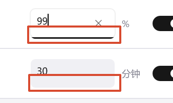

# Mem Reduct Fluent

原仓库：[henrypp/memreduct](https://github.com/henrypp/memreduct)，原作者：Henry++。

本仓库是个人自用改版，独立维护，不计划向原仓库提交 PR 或合并改动。
当前开发的是 **C# / WinUI 3 的 Windows 桌面改版**：内存监测、八项清理、数字托盘和统一设置页。
沿用原项目 [GPL-3.0 许可](LICENSE)，保留原作者署名和历史 Win32 实现。

## 接手先看这里

- 当前开发分支：`ui/winui3-rewrite`；交接时最后一笔应用代码提交为 `b6e45bb`。
- 新版入口：[modern/MemReduct.Fluent.csproj](modern/MemReduct.Fluent.csproj)。
- **根目录 `memreduct.sln`、`src/` 和 `UI-NOTES.md` 对应历史 Win32 版本，不能用来构建或解释新版界面。**
- 协作约定：[AGENTS.md](AGENTS.md)；Claude Code 入口：[CLAUDE.md](CLAUDE.md)。
- 详细开发指南、可复制的本机命令、配置与验证边界：[modern/README.md](modern/README.md)。

## 输入框高度：已修复，待用户验收

用户最后明确指出的是 **输入框的高度有问题**，不是在询问是否保留黑色焦点下划线。



2026-10-22 已定位根因并修复：两个 `NumberBox` 在水平 `StackPanel` 里默认垂直拉伸，
被旁边更高的 `ToggleSwitch` 撑到 40 DIP，而文字按 TextBox 规则顶对齐渲染，
于是文字贴顶、框底留白，聚焦时的黑色底边也画在留白之下、远离文字。
修复是在 `MainWindow.xaml` 的两个 `NumberBox` 上加 `VerticalAlignment="Center"`，
高度回到内容自撑的 32 DIP，不改动模板、清理逻辑与用户设置。
自检新增聚焦/失焦高度与文字居中断言（两语言通过：高度 32、中心偏差 0.33 DIP、聚焦前后上下边缘一致），
证据在 `..\MemReduct-Fluent-验证\height-before-zh-CN`（修复前）与 `height-zh-CN` / `height-en-US`（修复后）。
**等高与居中尚需用户在实际窗口验收**；实体键盘输入与更多 DPI 组合仍不在自检覆盖内。
历史背景见 [新版开发指南](modern/README.md#当前待办与已知问题)。

## 快速构建

需要 Windows x64 与 .NET 10 SDK。项目声明的最低系统版本为 Windows 10 19041；
目前本机界面验证基于 Windows 11，不代表其他系统与缩放设置已经验收。

日常开发先从托盘退出程序，再在仓库根目录执行：

```powershell
pwsh -File .\modern\build-dev.ps1
# 编译成功后按需打开；编译脚本不会自动运行或清理内存。
& '..\MemReduct-WinUI3-多语言预览\MemReduct.Fluent.exe'
```

脚本使用固定预览目录与 D 盘现有 SDK、NuGet、`obj` 缓存，运行增量 `dotnet build`，不生成第二份发布副本。
有意修改依赖时使用 `-Restore`；其他机器可用 `-BuildRoot <工具链目录>` 指定包含 `dotnet/dotnet.exe` 的目录。
脚本拒绝覆盖运行中的实例，并核对构建前后的 `settings.json` 哈希。不需要为查看文档先执行构建。
新版不依赖旧 C 工程的 `routine` / `builder`，不需要先初始化历史子模块。
运行时须保留整个输出目录，不能只复制 EXE；仅正式交付时再执行 `dotnet publish`。

## 主要功能与边界

- 每秒显示物理内存、已提交内存和系统文件缓存；“已提交”不是硬盘分页文件已用空间。
- 八项手动清理，每项有中英文说明；新增五项默认关闭。
- 带 `*` 的“已修改页面列表”和“全部备用列表”始终排除自动清理，即使用户勾选也一样。
- 自动清理支持 50–99% 阈值、1–1440 分钟间隔，两次自动尝试至少间隔 30 秒。
- 物理内存整数百分比托盘、关闭到托盘、置顶、当前用户开机启动。
- 托盘左键单击清理，右键菜单打开窗口、切换游戏模式或退出；遵循“手动清理前确认”，关闭确认后可一键清理，权限不足仍需 UAC。
- 数字颜色：低于 70% 绿色、70% 起橙色、90% 起红色；清理中紫色旋转弧线，成功绿色、错误橙色或红色，结果色保留 5 秒后恢复用量颜色。
- 游戏模式默认开启，自动检测前台独占/无边框全屏并暂停自动清理；全屏视频也受保护。离开全屏后至少缓冲 30 秒，原阈值、间隔和清理项保留；手动清理可用。
- 可选“清理成功后显示气泡通知”，默认关闭；有清理错误时不发送成功通知。通知静音并遵循 Windows 通知限制。
- 跟随系统/浅色/深色，顶部导航与侧栏切换，简体中文/English/跟随系统语言。
- 语言变更保存后提示“稍后重启 / 立即重启”；只重启程序，不重启电脑，不重复清理。

监测使用普通权限；真实清理需要管理员权限。自动清理在权限不足时暂停。
便携版设置仍在 EXE 旁；本项目安装版使用 `%LOCALAPPDATA%\MemReductFluent\settings.json`。
首次安装可选择导入便携版设置，原文件与已有安装版设置均保留；不迁移或覆盖 Henry++ 原版 INI，也不接管原版启动任务。

## 安装与更新

- 安装版固定在 `Program Files\MemReduct Fluent`，包含 .NET 与 WinUI 运行依赖。
- 安装后开启“开机启动”并授权一次，即注册当前用户的最高权限登录任务；之后登录无需重复确认。安装与升级本身仍可能需要管理员确认。便携版继续使用普通权限启动。
- 设置 → 关于 → 检查更新：只检查本仓库的正式 `fluent-vX.Y.Z` Release，确认后下载、校验 SHA-256 并打开安装向导；保留设置和启动选项。
- 当前已完成应用编译与自检。**安装包编译、实际安装/登录/升级/卸载尚待验证**；用户选择稍后准备 Inno Setup 编译器再生成安装包，没有发布 Release。

构建、发布约定和验收步骤见 [安装维护说明](modern/installer/README.md)。日常仍使用增量编译，不生成安装包。
完整清理项、原生调用和配置默认值见 [新版开发指南](modern/README.md)。

## 仓库导航

| 路径 | 用途 |
| --- | --- |
| [modern/](modern/) | 当前 WinUI 应用源码、资源、锁定依赖、内置自检 |
| [src/](src/) | 历史 Win32 C 实现，包含早期界面改动 |
| [memreduct.sln](memreduct.sln) | 历史 C++/Win32 工程，不包含 WinUI 项目 |
| [.github/workflows/windows-ui.yml](.github/workflows/windows-ui.yml) | 旧 Win32 构建流程，push 触发分支为 `ui/windows11-refresh` |
| [UI-NOTES.md](UI-NOTES.md) | 早期 Win32 改版说明，不是新版的交接规范 |
| [images/](images/) | 原版截图与已知问题截图 |

当前没有为 `ui/winui3-rewrite` 配置专门的 WinUI CI；旧流程的成功或失败都不能替代新版验证。

## 验证与交付

项目有内置 `--self-check <输出目录> --check-language zh-CN/en-US` 模式，
只读取内存并操作自身的测试窗口，输出 JSON 和 PNG，不进行真实清理或修改用户设置。
命令、覆盖范围和局限见 [验证说明](modern/README.md#验证与自检)。

既有记录包含中英文各 48 组布局、输入与失焦保存、数字托盘及原生结构布局检查。
**自检已断言输入框聚焦前后等高、文字居中及两行对齐；尚未验证实体键盘输入和跨显示器 DPI 切换。**
新增清理的实际效果、UAC、语言实际重启和重启电脑后的登录自启，仍需分别验证。
不要为了证明 UI 修改而执行真实内存清理、修改开机任务或覆盖用户设置。

---

## 原版项目说明（历史 Win32 版本）

以下保留上游介绍、下载和捐赠信息；其中系统要求、INI、签名与下载地址针对原版，
不是本分支 WinUI 便携预览的兼容性或签名承诺。

<p align="center">
	<a href="https://github.com/henrypp/memreduct/releases"></a>
	<a href="https://github.com/henrypp/memreduct/releases"></a>
	<a href="https://github.com/henrypp/memreduct/issues"></a>
	<a href="https://github.com/henrypp/memreduct/graphs/contributors"></a>
	<a href="https://github.com/henrypp/memreduct/blob/master/LICENSE"></a>
</p>

-------

<p align="center">
	
</p>

### Description:
Lightweight real-time memory management application to monitor
and clean system memory on your computer.

The program used undocumented internal system features (Native API) to clear system cache (system working set, working set, standby page lists, modified page lists) with variable result ~10-50%. Application it is compatible with <s>Windows XP SP3</s> Windows 7 SP1 and higher operating systems.

You can download either the installer or portable version. For correct working you are require administrator rights.

```
To activate portable mode, create "memreduct.ini" in application folder, or move it from "%APPDATA%\Henry++\Mem Reduct".
```

### System requirements:
- Windows 7, 8, 8.1, 10, 11 (64-bit/ARM64)
- An SSE2-capable CPU
- <s>KB2533623</s> [KB3063858](https://www.microsoft.com/en-us/download/details.aspx?id=47442) update for Windows 7 was required

### Donate:
- [Bitcoin](https://www.blockchain.com/btc/address/1LrRTXPsvHcQWCNZotA9RcwjsGcRghG96c) (BTC)
- [Ethereum](https://www.blockchain.com/explorer/addresses/eth/0xe2C84A62eb2a4EF154b19bec0c1c106734B95960) (ETH)
- [Yandex Money](https://yoomoney.ru/to/4100115776040583) (RUB)
- [Paypal](https://paypal.me/henrypp) (USD)

### GPG Signature:
Binaries have GPG signature `memreduct.exe.sig` in application folder.

- Public key: [pubkey.asc](https://raw.githubusercontent.com/henrypp/builder/master/pubkey.asc) ([pgpkeys.eu](https://pgpkeys.eu/pks/lookup?op=index&fingerprint=on&search=0x5635B5FD))
- Key ID: 0x5635B5FD
- Fingerprint: D985 2361 1524 AB29 BE73 30AC 2881 20A7 5635 B5FD
---
- Website: [github.com/henrypp](https://github.com/henrypp)
- Support: sforce5@mail.ru
---
(c) 2011-2026 Henry++
